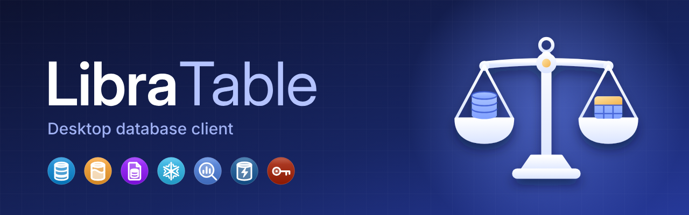
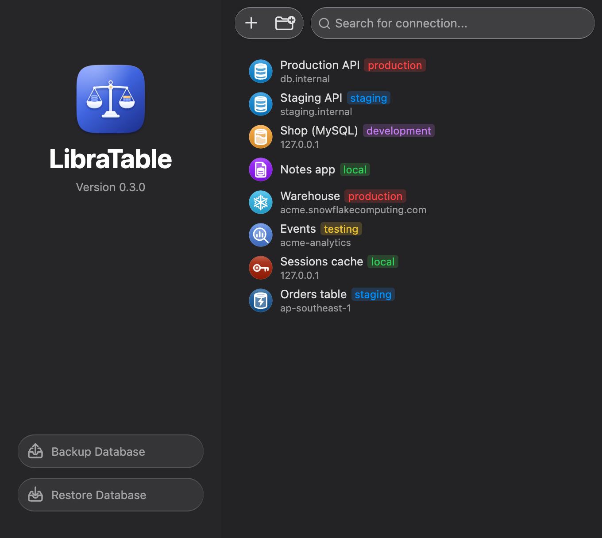
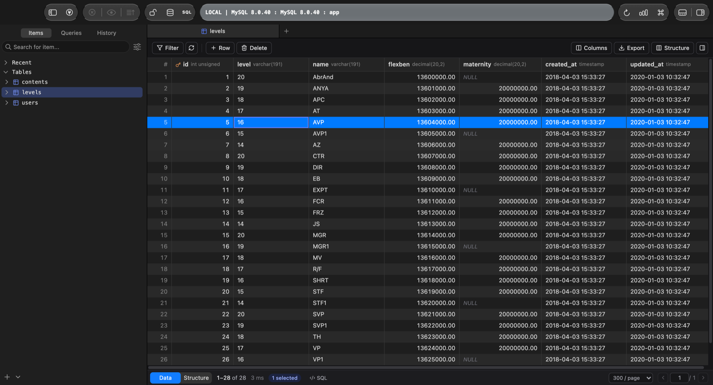
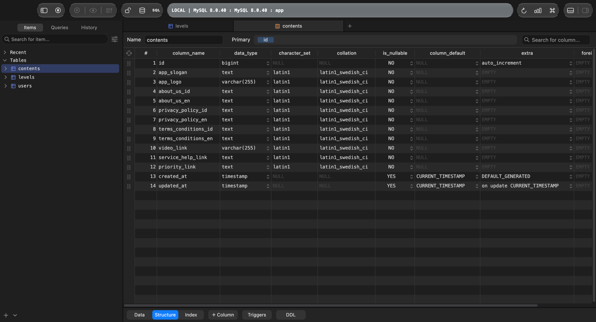

<p align="center">
  
</p>

<p align="center">
  <strong>Satu aplikasi desktop untuk semua database Anda.</strong><br>
  Buka, telusuri, ubah, dan kelola data dengan cepat, tanpa takut salah ubah di server produksi.
</p>

<p align="center">
  
  
  
</p>

---

## Kenapa LibraTable?

- **Satu tempat untuk banyak database.** PostgreSQL, MySQL, MariaDB, SQLite, Snowflake, BigQuery, DynamoDB, dan Redis dalam satu jendela, masing-masing di tab sendiri.
- **Terasa seperti aplikasi Mac.** Ringan, cepat dibuka, mengikuti mode terang/gelap, dan hampir semua aksi punya pintasan keyboard.
- **Aman untuk produksi.** Setiap perubahan ditampilkan dulu sebagai SQL sebelum dijalankan. Koneksi bertanda `production` meminta konfirmasi, dan koneksi read-only benar-benar ditolak oleh server.
- **Password tidak pernah disimpan di file.** Semua rahasia ada di Keychain macOS.
- **Pindah dari TablePlus dalam satu langkah.** Koneksi, grup, password, dan kunci SSH ikut terbawa.

## Tampilan

<p align="center">
  
</p>

| Data tabel | Struktur tabel |
| --- | --- |
|  |  |

## Database yang didukung

| | Database | Status |
| --- | --- | --- |
|  | PostgreSQL | Siap dipakai |
|  | MySQL | Siap dipakai |
|  | MariaDB | Siap dipakai |
|  | SQLite | Siap dipakai |
|  | Snowflake | Siap dipakai (diuji dengan tiruan layanan) |
|  | BigQuery | Siap dipakai (diuji dengan emulator) |
|  | DynamoDB | Siap dipakai (diuji dengan emulator) |
|  | Redis | Siap dipakai |
|  | CockroachDB, Redshift, Greenplum | Memakai mesin PostgreSQL, belum ada penyesuaian khusus |
|  | SQL Server, Oracle, ClickHouse, DuckDB, Cassandra, MongoDB, Elasticsearch, LibSQL, Cloudflare D1, Vertica | Segera hadir (tampil abu-abu di pemilih driver) |

## Fitur

**Koneksi**
- Langsung atau lewat **SSH tunnel** (password atau kunci, membaca `~/.ssh/config`, memeriksa host key) dan **SSL/TLS**.
- Grup bertingkat dengan ikon sendiri, tag lingkungan berwarna (`local`, `development`, `testing`, `staging`, `production`), **tag kustom** dengan warna sendiri (Settings › Tags), dan duplikat koneksi.
- Impor dari URL (`postgres://…`, `mysql://…`), dari file ekspor LibraTable terenkripsi, atau dari TablePlus.
- Tidak ada koneksi otomatis: tab terakhir dipulihkan, tetapi baru tersambung saat Anda klik.
- **Beberapa koneksi dan database sekaligus.** ⇧⌘K membuka koneksi lain tanpa meninggalkan yang sekarang. Database yang dibuka dengan ⌘K berjajar di rail kiri, dan sidebar ikut database dari tab yang aktif.
- **Beberapa jendela.** Buka koneksi di jendela sendiri (⌥⌘N atau klik kanan › Open in New Window) dan pindahkan tab ke jendela baru.
- **Reconnect** (⇧⌘R) bila koneksi ke server terputus, atau Reconnect All untuk semua koneksi.

**Data**
- Grid cepat untuk ribuan baris: urutkan, sembunyikan atau pindahkan kolom, ubah lebar, dan pindah halaman.
- **Filter** per kolom atau di semua kolom, termasuk *contains*, *between*, *in list*, dan Raw SQL. Tekan ↵ untuk menerapkan, **Clear** untuk menampilkan semua baris lagi.
- Edit sel langsung di grid, tambah atau hapus baris, lalu commit sekaligus. ⌘Z membatalkan, dan dropdown enum serta pemilih tanggal tersedia.
- **Duplikat dan paste baris.** ⌘D menduplikat baris terpilih (primary key otomatis dibiarkan ke database). ⌘V menempel baris yang di-copy sebagai baris baru, satu nilai ke sel yang dipilih, atau blok nilai mulai dari sel itu. Klik ganda di bawah baris terakhir menambah baris baru.
- **Pilih blok sel** dengan drag atau ⇧←/→, lalu copy hanya sel itu (⌘C) atau lewat *Copy cells as* CSV, JSON, SQL, Markdown, HTML. Satu nilai yang di-paste mengisi seluruh blok.
- **Jump to column or row** (⌘J): cari nama kolom, nomor baris, atau nilai, lalu langsung lompat ke sana.
- **Search & replace di tabel** (⌥⌘R) dengan Match Case, Whole Word, dan Regex. Hasil replace menjadi perubahan yang tinggal di-commit.
- Menu header kolom: Size to fit (atau klik ganda tepi kolom), Copy column values, Remove sort, Reset column positions.
- **Quick Look** (Spasi) untuk JSON, gambar, dan data biner. Klik foreign key untuk membuka baris yang dirujuk.
- Pengaturan grid: tinggi baris, baris selang-seling, nomor baris, dan pilihan membuka tabel di tab baru atau di tab yang sama (dengan Back/Forward ⌥⌘[ / ⌥⌘]).

**Struktur tabel**
- Tab **Data | Structure | Index** di tab yang sama: ubah nama, tipe, nullable, default, extra, charset, collation, dan komentar kolom lewat menu atau ketik langsung.
- Tarik kolom untuk mengubah urutan (MySQL), buat foreign key dari selnya, tambah index, lihat trigger, dan lihat DDL.
- Semua perubahan ditampilkan sebagai SQL dulu, lalu dijalankan dengan ⌘S.
- Dari sidebar: *Copy script as* CREATE, DROP, TRUNCATE, SELECT, INSERT, UPDATE, DELETE, dan rename database (PostgreSQL).
- **Compare schema**: bandingkan tabel dan kolom dengan database atau koneksi lain, lalu buka skrip sinkronisasinya di tab query untuk diperiksa sebelum dijalankan.

**Query**
- Editor SQL dengan pelengkapan otomatis, format (⌥⌘F), Explain (⌥⌘E), dan variabel `:nama`.
- Jalankan statement di kursor (⌘↵) atau semuanya (⇧⌘↵), batalkan query yang sedang berjalan (⌘.), simpan query favorit dalam **folder**, dan cari di **riwayat**.
- Mode **Vim**, UPPERCASE keyword otomatis, kurung otomatis, block comment (⌥⌘/), trim whitespace, ubah indentasi, dan transform teks (huruf besar/kecil, full-width, kana, Unicode).
- Format variabel bisa dipilih: `:nama`, `$nama`, `${nama}`, `{{nama}}`, atau `%nama%`.
- **SQL assistant** (opsional, ⇧⌘I): tulis permintaan dalam bahasa biasa, SQL-nya masuk ke editor. Memakai API key Anthropic Anda (disimpan di Keychain). Hanya pertanyaan, nama tabel/kolom, dan query di editor yang dikirim; isi baris tidak pernah dikirim.
- Ekspor hasil dari semua tab hasil sekaligus, satu file per hasil.

**Impor, ekspor, dan alat server**
- Impor CSV/JSON ke tabel yang ada atau tabel baru, dan jalankan file SQL besar.
- Ekspor ke CSV, JSON, atau SQL, termasuk beberapa tabel sekaligus.
- Backup dan restore (`pg_dump`/`mysqldump`), daftar proses (cancel/kill), serta pengguna dan hak akses.
- **Backup terjadwal**: per jam, harian, atau mingguan ke folder pilihan, menyimpan N backup terbaru. Berjalan selama LibraTable terbuka.

**Tampilan**
- Tema warna bawaan (Midnight Teal, Graphite, Dusk, Paper) dan impor file tema JSON.

**Visual**
- **Diagram ER** yang bisa digeser dan diekspor ke SVG/PNG.
- **Papan metrik** berisi angka, tabel, grafik batang, garis, dan pie dengan refresh otomatis.

## Mulai

### Kebutuhan

- macOS 13 atau lebih baru (Apple Silicon sudah diuji)
- [Rust](https://rustup.rs) 1.82 atau lebih baru, beserta Xcode Command Line Tools
- [Node.js](https://nodejs.org) 22 dan [Bun](https://bun.sh) 1.3 atau lebih baru

### Jalankan

```bash
bun install
bun tauri dev                    # aplikasi dengan hot reload
```

### Buat aplikasinya

```bash
bun tauri build --bundles app    # LibraTable.app di src-tauri/target/release/bundle/macos
bun tauri build                  # .app + .dmg (jalankan dari sesi desktop; langkah DMG memakai Finder)
```

> Ingin mencoba tanpa menyentuh koneksi yang sudah tersimpan? Jalankan dengan
> `LIBRATABLE_DATA_DIR=/folder/kosong`.

## Pindah dari TablePlus

1. Di TablePlus, ekspor koneksi Anda menjadi file `.tableplusconnection` dan ingat password ekspornya.
2. Di LibraTable, klik **+** di layar awal, lalu **Import Connection → From TablePlus…**. Bisa juga klik kanan area kosong daftar koneksi, lalu pilih **Import from TablePlus…**.
3. Pilih file tersebut dan masukkan password ekspornya.

Koneksi, grup bertingkat, password, dan kunci SSH ikut terbawa. Koneksi yang sudah ada di LibraTable dilewati, jadi impor aman diulang.

## Pintasan keyboard

| Tombol | Aksi |
| --- | --- |
| ⌘N | Koneksi baru |
| ⌘P | Buka tabel, view, atau query |
| ⌘K | Buka database lain |
| ⇧⌘K | Buka koneksi lain |
| ⌘T / ⌘W | Tab query baru / tutup tab |
| ⌘F | Filter baris |
| ⌘I / ⌘D | Tambah baris / duplikat baris terpilih |
| ⌘C / ⌘V | Copy baris atau blok sel / paste baris atau nilai |
| ⌘J | Lompat ke kolom, baris, atau nilai |
| ⌥⌘R | Cari dan ganti di tabel |
| ⌥⌘[ / ⌥⌘] | Back / Forward di tab |
| ⌥⌘N | Koneksi ini di jendela baru |
| ⇧⌘R | Reconnect |
| ⇧⌘I | SQL assistant (bila diaktifkan) |
| ⌘S | Simpan query, commit perubahan, atau terapkan struktur |
| ⌘R | Muat ulang |
| ⇧⌘S | Tampilkan struktur tabel |
| ⌘↵ / ⇧⌘↵ | Jalankan statement di kursor / semua statement |
| ⇧⌘C | Log console (setiap statement yang dikirim ke server) |
| ⇧⌘L | Kunci LibraTable dengan passcode |
| ⌘/ | Lihat semua pintasan (bisa diubah) |

## Keamanan dan privasi

- **Rahasia hanya di Keychain macOS.** Password, kunci SSH, dan passphrase disimpan di Keychain (layanan `com.libratable.app`). File konfigurasi tidak pernah berisi rahasia.
- **Nilai selalu dikirim sebagai parameter.** Filter dan edit tidak pernah menempelkan nilai ke dalam SQL.
- **Safe mode dijaga oleh backend.** Perubahan pada koneksi `production` (atau sesuai pengaturan per koneksi) harus dikonfirmasi. Mode "safe" bahkan meminta Anda mengetik nama koneksi.
- **Read-only sungguhan.** Koneksi read-only ditolak oleh aplikasi dan oleh sesi server (`READ ONLY`).
- **Passcode** untuk mengunci aplikasi, dengan kunci otomatis setelah tidak dipakai.

Data aplikasi disimpan di `~/Library/Application Support/com.libratable.app/`.

## Performa

Diukur dengan build release di Mac Apple Silicon:

| Uji | Hasil |
| --- | --- |
| Mencari satu kata di 100.000 entri riwayat | 11 ms |
| Ekspor 5.000.000 baris ke CSV | memori naik hanya +2 MB (file 264 MB dalam 10,2 detik) |
| Bundel JS utama | 163 kB (gzip). Editor SQL, diagram ER, metrik, dan ilustrasi dimuat terpisah |

## Keterbatasan saat ini

- Baru diuji di macOS (arm64). Build Windows dan Linux belum diuji.
- Belum ada auto-update dan notarization. Build lokal ditandatangani ad-hoc, jadi setelah build ulang macOS meminta izin Keychain sekali per koneksi.
- Urutan kolom hanya bisa diubah di MySQL; PostgreSQL dan SQLite tidak mendukung pemindahan kolom.
- Nilai biner belum bisa diedit (bisa dilihat di Quick Look dan diekspor utuh).
- `verify-full` PostgreSQL lewat SSH tunnel gagal memverifikasi hostname.
- Index pada kolom TEXT/BLOB MySQL belum bisa diberi panjang prefix dari editor index.

---

## Untuk pengembang

### Teknologi

**Tauri 2 (Rust, Tokio, sqlx)** untuk inti aplikasi, serta **React 18, TypeScript, Zustand, dan Vite** untuk antarmuka.

```
React UI (webview)  ──invoke / events──▶  Rust core
```

### Tes dan lint

```bash
bun run check        # tsc + eslint + prettier --check + vitest
bun run test         # vitest saja (jangan `bun test`, itu runner milik Bun)
cd src-tauri && cargo test
cargo fmt --check && cargo clippy --all-targets -- -D warnings
```

Tes end-to-end PostgreSQL dan MySQL berjalan bila URL admin diberikan. Tanpa URL itu, hanya SQLite yang diuji. Setiap suite membuat database `libratable_*` sendiri dan menghapusnya lagi.

```bash
LIBRATABLE_TEST_PG_URL=postgres://postgres@127.0.0.1:5432/postgres \
LIBRATABLE_TEST_MYSQL_URL=mysql://root@127.0.0.1:3306/mysql \
cargo test
```

### Struktur folder

```
src/                 antarmuka React
  app/               shell, toolbar, menu, pintasan global
  features/          satu folder per layar (connections, data, structure, query, …)
  components/        komponen bersama (grid, dialog, menu, ilustrasi brand)
  store/ services/ api/ domain/ types/ lib/ styles/
src-tauri/src/       inti Rust
  commands/          perintah IPC per domain
  connections/       simpan, sambung, SSH, impor/ekspor koneksi (termasuk TablePlus)
  db/                pool, filter, DDL, metadata per driver
  engines/           Snowflake, BigQuery, DynamoDB, Redis, …
  storage/           konfigurasi JSON, Keychain, riwayat (SQLite + FTS5)
public/brand/        logo, badge driver, dan ilustrasi empty state
```

Aturan kode: baris paling panjang 100 karakter (Prettier/ESLint dan `rustfmt`), TypeScript strict tanpa `any`, dan arah dependensi `features → services/store → api → types`.

Aset brand dipakai lewat `vite.brand.ts`: ilustrasi empty state dibaca sebagai modul, sehingga warnanya mengikuti tema aplikasi. Saat build, isi `brand/` di folder `dist` dipangkas sampai tinggal badge driver, jadi file desain lain tidak ikut ke dalam aplikasi.
