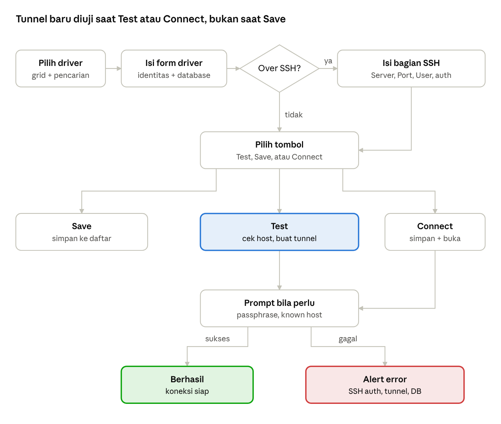

# Checklist: Koneksi Baru via SSH Tunnel

2026-10-24 · Mas Gopal · [Versi live](https://claude.ai/artifact/UvZwEF75PAWFmkMSGvyvJj)

## Ringkasan

Membuat koneksi lewat SSH tunnel di TablePlus 27.1.0 butuh 3 layar: pilih driver, isi form driver, lalu aktifkan bagian **Over SSH** di form yang sama. Hampir tidak ada validasi saat mengetik; pemeriksaan terjadi saat **Test** atau **Connect**, ketika tunnel benar-benar dibuat.

- **Contoh driver:** PostgreSQL. Form driver lain (MySQL, SQL Server, dan seterusnya) memakai bagian SSH yang sama (`ConnectionPartSSHController`); hanya field database yang berbeda.
- **Cara rekam:** ini rekonstruksi statis dari NIB form, method ObjC, dan string pesan di binary, bukan rekaman layar. TablePlus tidak saya jalankan karena saat dibuka ia bisa memulihkan workspace terakhir dan otomatis connect ke server sungguhan (lihat bagian Bukti).
- **Hasil simpan:** satu entri di `Connections.plist`. Password dan private key disimpan ke Keychain (service `com.tableplus.TablePlus`, account `<ID>_database`, `<ID>_host`, `<ID>_private_key_data`, `<ID>_private_key_pass`).

## Alur

Save langsung menyimpan tanpa menyentuh jaringan. Test dan Connect sama-sama membuat tunnel, jadi prompt passphrase dan known host bisa muncul di keduanya; peringatan Host == SSH Server hanya dicek di Test.

## Langkah-langkah

Centang setiap langkah yang sudah ada di UI-mu. Sub-poin adalah perilaku yang perlu ditiru.

- [ ] **1. Buka pembuat koneksi.** Dari jendela Open Connection: tombol `New...` atau menu `New › Connection...`.
    - [ ] Jendela pemilih driver (`CreateConnectionWindow`) berisi grid driver dan kolom pencarian.
    - [ ] Tombol bawah: `Create`, `Cancel`, `New Group`, `Import Connection` (submenu `From URL...` dan `From File...`).
- [ ] **2. Pilih driver** (misalnya PostgreSQL), lalu `Create`. Form driver terbuka dengan judul `<Driver> Connection`.
- [ ] **3. Isi identitas koneksi** di bagian atas form: Name, Status Color, Tag, dan Safe Mode.
- [ ] **4. Isi field database:** Host/Socket, Port, User, Password beserta mode simpannya, dan Database.
    - [ ] Untuk tunnel, Host diisi alamat database **dilihat dari SSH server** (biasanya `127.0.0.1`).
- [ ] **5. Aktifkan `Over SSH`.** Bagian SSH muncul atau aktif (`toggleOverSSH:`).
    - [ ] Isi Server, Port, User, dan Password beserta mode simpannya.
- [ ] **6. (Opsional) Autentikasi dengan key.** Centang `Use SSH key`, lalu `Import a private key...`.
    - [ ] File picker dibuka di `~/.ssh` dengan judul `Choose SSH Private Key...`.
    - [ ] Ada tombol hapus key (`clearPrivateKey:`).
    - [ ] Jika key dikosongkan, `~/.ssh/config` yang dipakai (teks bantuan di form).
- [ ] **7. (Opsional) Pilih versi library SSH** dari menu opsi SSH (`showSSHMenuOption:`): SSH Version 0.9.5, 0.11, atau 0.12.
- [ ] **8. (Opsional) Isi TLS dan opsi lanjutan:** SSL mode, Negotiation, SSL keys, Bootstrap commands, Other options.
- [ ] **9. `Test`.** Field dibaca, tunnel dibuat (status `Creating tunnel...`), lalu koneksi DB dicoba.
    - [ ] Peringatan "Host sama dengan SSH Server" dicek di langkah ini (lihat Validasi).
    - [ ] Prompt yang mungkin muncul: passphrase private key, verifikasi known host.
- [ ] **10a. `Save`.** Koneksi disimpan ke daftar tanpa dibuka.
- [ ] **10b. `Connect`.** Koneksi disimpan, lalu workspace dibuka.

## Field form: identitas dan database

Tidak ditemukan pemeriksaan wajib-isi di jalur Save; nilai kosong tampaknya jatuh ke default yang ditampilkan sebagai placeholder. Buktinya, dari 48 koneksi tersimpan di Mac ini, `DatabasePort` hanya terisi di 9 dan `DatabaseHost` di 21.

| Label UI | Kontrol | Placeholder / pilihan | Key di Connections.plist |
| --- | --- | --- | --- |
| Name | Text field | `Mochi` | `ConnectionName` |
| Status Color | Color well | — | `statusColor`, `statusColorIndex` |
| Tag | Popup | local, testing, development, staging, production | `Enviroment` |
| Safe Mode | Popup | Silent Mode (default), Alert Mode 1, Alert Mode 2, Safe Mode 1, Safe Mode 2 | Keychain `_safe_mode` (dari kode, belum terlihat di data) |
| Host/Socket | Text field | `127.0.0.1` | `DatabaseHost`, `DatabaseSocket`, `isUseSocket` |
| Port | Text field | `5432` (MySQL `3306`) | `DatabasePort` (string) |
| User | Text field | `user name` | `DatabaseUser` |
| Password | Secure field | `password` | Keychain `<ID>_database` |
| Mode password | Popup | Store in keychain, Ask every time, No password, Command Line | `DatabasePasswordMode` (int) |
| Database | Text field | `database name` | `DatabaseName` |
| SSL mode | Popup | PREFERRED, DISABLED, REQUIRED, ALLOW, VERIFY-CA, VERIFY-FULL | `tLSMode` |
| Negotiation | Popup | POSTGRES, DIRECT | `tLSNegotiation` |
| SSL keys | Tombol | Key..., Cert..., CA Cert... | `TlsKeyName`, `TlsKeyPaths` |
| Bootstrap commands | Tombol → editor | — | `StartupCommands` |
| Other options | Menu centang | Load system schemas, Disable channel binding | `OtherOptions`, `ShowSystemSchemas` |
| Tombol aksi | Button | Connect, Test, Save | — |

Perbedaan di form MySQL: Host bisa diganti `Host/IP` atau `Socket` lewat popup, ada `SNI routing`, `Dialect` (Default, Old - Old MySQL, SingleStore DB), SSL mode memakai `VERIFY-IDENTITY` (tanpa `ALLOW`), dan Other options berisi `Enable CLEARTEXT_PLUGIN` serta `Enable LOAD DATA LOCAL INFILE`.

## Field form: SSH tunnel

Bagian SSH hanya aktif setelah `Over SSH` dicentang. Port SSH kosong berarti 22: dari 37 koneksi SSH tersimpan, hanya 2 yang mengisi `ServerPort`.

| Label UI | Kontrol | Placeholder / pilihan | Key di Connections.plist |
| --- | --- | --- | --- |
| Over SSH | Checkbox | Mati secara default | `isOverSSH` |
| Server | Text field | `192.168.1.1` | `ServerAddress` |
| Port | Text field | `22` | `ServerPort` (string) |
| User | Text field | `user name` | `ServerUser` |
| Password | Secure field | `password` | Keychain `<ID>_host` |
| Mode password | Popup | Store in keychain, Ask everytime, No password | `ServerPasswordMode` (int) |
| Use SSH key | Checkbox | Mati secara default | `isUsePrivateKey` |
| Private key | Tombol `Import a private key...` + tombol hapus | Picker di `~/.ssh` | `ServerPrivateKeyName` (nama); isi key di Keychain `<ID>_private_key_data` |
| Passphrase key | Prompt saat Test/Connect (bukan field) | `Please enter SSH private key password` | Keychain `<ID>_private_key_pass` |
| Versi SSH | Menu opsi | SSH Version 0.9.5, 0.11, 0.12 | Disimpan per koneksi (`SSH_0.9.5` / `SSH_0.12`); key plist-nya belum teridentifikasi |
| Teks bantuan | Label | "TablePlus will use ~/.ssh/config if you leave private key empty" | — |

Catatan untuk UI-mu:

- [ ] Password SSH dan private key bisa sama-sama tersimpan untuk satu koneksi (di Mac ini ada 24 item `_host` dan 17 `_private_key_data`); UI tidak memaksa memilih salah satu.
- [ ] Isi private key ikut disalin ke Keychain, jadi koneksi tetap jalan walau file aslinya dipindah.
- [ ] Debug log SSH bisa dinyalakan secara global (setting `IsEnableSSHDebugLog`).

## Validasi dan pesan error

Validasi terbagi tiga waktu: saat memilih key, saat Test, dan saat tunnel/koneksi dibuat. Pesan ditampilkan sebagai alert dengan judul Warning, Error, atau Info.

**Saat memilih private key** (`0x10064e8bc`)

- [ ] File berekstensi `.pub` → Warning: "You seem selected the wrong private key, the correct file have no extension"
- [ ] File tidak bisa dibaca → Error: "Can't read private key"

**Saat Test** (`testConnection:` → `0x1004a0a20`)

- [ ] `Over SSH` aktif **dan** Host database == SSH Server **dan** Host ≠ `127.0.0.1` → Warning: "You're using SSH Tunnel but the Host IP and SSH Server IP are the same, this could cause a connection issue. We recommend you to replace the Host IP with 127.0.0.1". Ini hanya peringatan; proses tidak diblokir.
- [ ] Cek ini dipanggil dari 16 form driver. Di form PostgreSQL, Save dan Connect tidak memanggilnya.

**Saat tunnel dan koneksi dibuat** (Test dan Connect)

| Kondisi | Pesan | Aksi user |
| --- | --- | --- |
| Tunnel sedang dibuat | `Creating tunnel...` (status) | — |
| Key terenkripsi | Info: "Please enter SSH private key password" | OK / Cancel; passphrase disimpan ke Keychain |
| Passphrase salah | Error: "The passphrase was wrong or unsupported private key. Re-enter the passphrase" | Prompt diulang |
| Host key tidak dikenal / berubah | Warning: "Can't verify the known host" | `Continue & Update known hosts` / `Cancel` |
| Gagal menulis known_hosts | "Couldn't write known hosts" | — |
| Server SSH tidak terjangkau | "Can't connect to the SSH server" | — |
| Login SSH ditolak | "SSH authentication failed" | — |
| Tunnel gagal | "Failed to create tunnel" / "Create tunneling failed" | — |
| Koneksi DB lewat tunnel gagal | "Can't create connection", "The database does not exist", "Invalid SSL configuration", "The connection ended" | — |
| Bootstrap commands gagal | "Bootstrap command error" | — |
| Mode password = Ask every time | Prompt password saat connect (pesan DB: "Please enter your Database Password here") | OK / Cancel |

Yang **tidak** ditemukan di binary, jadi mungkin perlu kamu tambahkan sendiri: validasi format port (angka 1–65535), field wajib saat Save, dan batas waktu koneksi SSH yang bisa diatur dari form.

## Bukti dan catatan

Semua isi checklist ini berasal dari file aplikasi; UI belum direkam secara live.

| Sumber | Yang diambil |
| --- | --- |
| NIB `CreateConnectionWindow`, `ConnectionPartNameController`, `ConnectionPartSSHController`, `PostgreSQLForm`, `MySQLForm`, `ConnectionWindow` | Label, placeholder, isi popup, dan tombol |
| Method ObjC `ConnectionPartSSHController` dan `PostgreSQLForm` | Aksi: `toggleOverSSH:`, `usePrivateKey:`, `choosePrivateKey:`, `clearPrivateKey:`, `enableSSHVersion:`, `testConnection:`, `saveConnection:`, `connectionDatabase:` |
| Assembly arm64 | Kondisi peringatan host (`0x10064dc30`), cek file key (`0x10064e8bc`), rantai Test/Save/Connect (`0x1004a0a20` / `0x1004a0b6c` / `0x1004a0c2c`) |
| `Connections.plist` dan Keychain di Mac ini (key dan jumlah saja, tanpa nilai) | Pemetaan field ke penyimpanan dan bukti default port |

Belum terverifikasi:

- [ ] Tata letak dan urutan visual field (posisi SSH di bawah atau di samping field DB).
- [ ] Apakah bagian SSH disembunyikan atau hanya di-disable saat `Over SSH` mati.
- [ ] Urutan prompt yang sebenarnya saat Test (passphrase vs known host).
- [ ] Key plist untuk versi SSH.

**Kenapa belum direkam live.** TablePlus sedang tidak berjalan, dan `Settings.json` menyimpan workspace tertutup yang bisa dibuka ulang saat start (setting "Reopen closed workspaces at startup"). Membuka app berisiko memicu koneksi otomatis ke server sungguhan.
