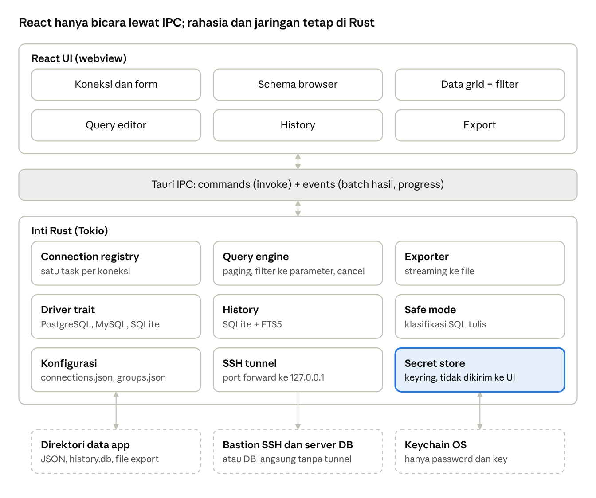

# PRD: Database Client (Tauri + React)

2026-10-24 · Mas Gopal · [Versi live](https://claude.ai/artifact/2Lk3eowvPMbrSU2inWMBx7)

## Ringkasan

MVP adalah database client desktop untuk **PostgreSQL, MySQL/MariaDB, dan SQLite**. Cakupannya: koneksi langsung atau lewat SSH tunnel, browsing schema, data grid dengan filter dan edit sel, query editor, history, serta export CSV/JSON. Fitur lain dari TablePlus (metrics board, ER diagram, AI/MCP, plugin, backup/restore, dan 17 driver lain) masuk rilis berikutnya.

- **Pengguna:** developer backend dan data engineer yang sehari-hari membuka beberapa database sekaligus, sering lewat bastion SSH ke staging atau production.
- **Stack:** Tauri 2 (inti Rust untuk driver, SSH, dan keychain) dan React (UI). Semua I/O jaringan dan rahasia berada di sisi Rust; React tidak pernah memegang password.
- **Acuan:** hasil reverse engineering TablePlus 27.1.0, yaitu model data koneksi, penyimpanan di Keychain, perilaku filter, dan alur SSH. Di beberapa titik PRD ini sengaja lebih baik dari TablePlus, misalnya parameter binding untuk filter dan history yang bisa dicari.

**Prinsip produk**

1. **Aman secara default.** Rahasia hanya di keychain OS, koneksi production diberi tanda jelas, dan query tulis di production minta konfirmasi.
2. **Cepat dibuka, cepat dipakai.** App siap dalam kurang dari 1 detik, dan data grid tetap mulus walau tabelnya jutaan baris.
3. **Satu model untuk semua driver.** UI bicara ke satu antarmuka driver; perbedaan antar database diekspresikan sebagai *capability*, bukan cabang khusus di UI.

## Arsitektur

React hanya memanggil command Tauri dan menerima event. Driver, tunnel, rahasia, dan penulisan file semuanya di Rust. Hasil query dialirkan per batch lewat event supaya grid bisa mulai tampil sebelum semua baris tiba. Garis putus-putus menandai sistem di luar app.

## Peta rilis

MVP mencakup 8 modul inti dengan 3 driver. Semua yang ada di kolom Nanti tidak memblokir MVP.

| Modul | MVP | Nanti |
| --- | --- | --- |
| Koneksi | Daftar, grup satu tingkat, form untuk 3 driver, Tag + warna, duplikat, hapus, import dari URL | Grup bersarang, import/export file terenkripsi, folder bersama tim, driver tambahan |
| SSH tunnel dan TLS | Tunnel lewat password atau private key, `~/.ssh/config`, known_hosts, SSL mode dasar | Jump host berantai, SSH agent forwarding, sertifikat klien per driver, HTTP proxy |
| Kredensial dan penyimpanan | Keychain OS, file konfigurasi JSON, state kolom per tabel | Sinkronisasi antar perangkat, kunci aplikasi (passcode / Touch ID) |
| Schema browser | Daftar schema, tabel, view, dan kolom; pencarian; buka struktur | Function, sequence, tipe custom, pin, grup item |
| Data grid dan filter | Paging, sort, filter multi-baris (AND), edit sel dengan commit eksplisit, salin baris | Grup OR, quick filter dari sel, kolom JSON tree, edit massal |
| Query editor dan history | Syntax highlight, autocomplete nama, run current/all, multi-result, history yang bisa dicari, query tersimpan | Formatter, folding, mode Vim, variabel `${name}`, query bersama |
| Import/Export | Export CSV, JSON, dan SQL INSERT dari hasil atau tabel | Import CSV/JSON/SQL dengan wizard, export XLSX, backup/restore native (`pg_dump`, `mysqldump`) |
| Safe mode | Konfirmasi query tulis untuk koneksi bertag production | 5 mode ala TablePlus, termasuk prompt password |
| Lainnya | — | Metrics board, ER diagram, AI chat dan server MCP, plugin, tema, manajemen user/privilege |

## Modul: Koneksi

User bisa membuat, mengatur, dan membuka koneksi ke 3 driver MVP dalam kurang dari 1 menit.

**MVP**

- [ ] **CON-1 Daftar koneksi** di layar awal: nama, driver, host atau path, warna status, dan tag. Ada pencarian, serta urut berdasarkan nama, driver, atau tag.
- [ ] **CON-2 Grup** satu tingkat yang bisa dilipat. Setiap koneksi punya `groupId`.
- [ ] **CON-3 Buat koneksi:** pilih driver dari grid dengan pencarian, lalu tampil form driver.
- [ ] **CON-4 Field identitas:** Name, Status Color, dan Tag (`local`, `testing`, `development`, `staging`, `production`).
- [ ] **CON-5 Field database** per driver. PostgreSQL dan MySQL: Host/Socket, Port, User, Password + mode (Simpan di keychain / Tanya tiap kali / Tanpa password), Database. SQLite: path file.
- [ ] **CON-6 Placeholder adalah default.** Field kosong memakai default (`127.0.0.1`, `5432`/`3306`), dan default diselesaikan di Rust saat connect, bukan disimpan.
- [ ] **CON-7 Tombol Test, Save, Connect.** Save tidak menyentuh jaringan; Test dan Connect membuka koneksi (dan tunnel jika ada).
- [ ] **CON-8 Import dari URL:** `postgresql://`, `postgres://`, `mysql://`, dan `postgresql+ssh://`, termasuk deep link dari OS.
- [ ] **CON-9 Edit, duplikat** (tanpa menyalin password, kecuali user memilih), **hapus** (rahasia di keychain ikut dihapus), dan **salin sebagai URL** (tanpa password).

**Nanti**

- Grup bersarang, import/export file koneksi terenkripsi, dan folder bersama tim (password tidak pernah ikut, sama seperti TablePlus).
- Driver tambahan lewat antarmuka driver yang sama: SQL Server, ClickHouse, DuckDB, MongoDB, Redis, dan lainnya.
- Opsi per koneksi: batas baris, startup commands, sembunyikan schema sistem.

**Kriteria penerimaan**

- Koneksi PostgreSQL lokal bisa dibuat dan dibuka dengan hanya mengisi Name dan Password.
- Menghapus koneksi juga menghapus semua item keychain-nya; tidak ada sisa di file konfigurasi.

## Modul: SSH tunnel dan TLS

User bisa menjangkau database di balik bastion tanpa membuka terminal. Tunnel dibuat dan diputus otomatis bersama koneksi.

**MVP**

- [ ] **SSH-1 Toggle `Over SSH`** di form koneksi. Field Server, Port (default 22), User, Password + mode.
- [ ] **SSH-2 Private key:** pilih file (picker dibuka di `~/.ssh`), tombol hapus, dan prompt passphrase saat connect. Isi key disalin ke keychain, jadi koneksi tidak rusak saat file dipindah.
- [ ] **SSH-3 Fallback ke `~/.ssh/config`** (Host, User, IdentityFile, Port) saat key dikosongkan.
- [ ] **SSH-4 known_hosts:** host baru atau key berubah memunculkan dialog fingerprint dengan pilihan "Lanjut & perbarui" atau "Batal".
- [ ] **SSH-5 Port forward lokal:** Rust membuka listener di `127.0.0.1:<port acak>`, dan driver connect ke situ.
- [ ] **SSH-6 Peringatan saat Test** jika Host DB sama dengan SSH Server dan bukan `127.0.0.1`. Peringatan saja, tidak memblokir.
- [ ] **SSH-7 Error yang dibedakan:** server SSH tak terjangkau, autentikasi SSH gagal, passphrase salah, tunnel gagal, dan koneksi DB gagal lewat tunnel. Setiap error disertai saran.
- [ ] **TLS-1 SSL mode** per driver (PostgreSQL: disable, allow, prefer, require, verify-ca, verify-full; MySQL: disabled, preferred, required, verify-ca, verify-identity), serta file Key, Cert, dan CA.

**Nanti**

- Jump host berantai (`ProxyJump`), SSH agent, dan autentikasi keyboard-interactive / 2FA.
- Keep-alive dan reconnect otomatis tunnel saat jaringan berganti.
- Pilihan backend SSH (TablePlus membundel 3 versi libssh untuk kompatibilitas server lama).

**Kriteria penerimaan**

- Connect lewat bastion dengan key terenkripsi meminta passphrase sekali, lalu menyimpannya ke keychain bila user memilih.
- Setiap kegagalan menunjukkan *lapisan mana* yang gagal (SSH atau DB) dalam satu kalimat.

## Modul: Kredensial dan penyimpanan lokal

Rahasia hanya ada di keychain OS. Semua data lain berupa file biasa di direktori data aplikasi Tauri, jadi bisa di-backup dan dibaca manusia.

**MVP**

- [ ] **STO-1 Keychain** lewat crate `keyring` (Keychain di macOS, Credential Manager di Windows, Secret Service di Linux). Service = bundle ID, account = `<connectionId>_<jenis>`.

| Jenis | Isi |
| --- | --- |
| `db_password` | Password database |
| `ssh_password` | Password SSH |
| `ssh_key` | Isi private key |
| `ssh_key_passphrase` | Passphrase private key |

- [ ] **STO-2 `connections.json`** berisi array koneksi dengan field: `id`, `name`, `groupId`, `driver`, `tag`, `color`, `db{host, port, user, database, socket, passwordMode}`, `ssh{enabled, host, port, user, passwordMode, useKey, keyName}`, `tls{mode, keyPath, certPath, caPath}`, `options{}`, serta `schemaVersion` untuk migrasi. Tidak ada field rahasia; ini divalidasi saat tulis.
- [ ] **STO-3 `groups.json`:** `id`, `name`, `parentId` (null di MVP), `collapsed`.
- [ ] **STO-4 State per tabel:** urutan dan lebar kolom, filter terakhir, dan sort. Disimpan per `connectionId/db.schema.table`.
- [ ] **STO-5 Workspace:** tab yang terbuka per koneksi dipulihkan saat start **tanpa auto-connect**. User menekan sekali untuk menyambung ulang. (Pelajaran dari TablePlus: auto-reopen bisa diam-diam connect ke production.)
- [ ] **STO-6 Tulis atomik** (tulis ke file sementara lalu rename) dan cadangan `.bak` sebelum migrasi skema.

**Nanti**

- Kunci aplikasi dengan passcode atau Touch ID.
- Sinkronisasi koneksi tanpa rahasia lewat folder bersama atau cloud.
- Export koneksi terenkripsi dengan password, termasuk rahasianya.

**Kriteria penerimaan**

- `grep` password apa pun di direktori data aplikasi tidak menemukan hasil.
- File konfigurasi dengan `schemaVersion` lama termigrasi otomatis saat start, dan salinan `.bak` tersimpan di sebelahnya.

## Modul: Schema browser

Sidebar kiri menampilkan isi database yang sedang dibuka, dan bisa dicari dengan mengetik beberapa huruf.

**MVP**

- [ ] **SCH-1 Pemilih database dan schema** di atas sidebar (PostgreSQL: schema; MySQL: database; SQLite: `main` + attached).
- [ ] **SCH-2 Seksi** Tables dan Views, dengan jumlah item. Kolom tabel bisa ditampilkan saat item dibuka.
- [ ] **SCH-3 Pencarian** dengan dua mode: fuzzy (default) dan contains. Hasil disorot.
- [ ] **SCH-4 Aksi item:** buka data, buka struktur, salin nama, dan salin `SELECT * … LIMIT 100`.
- [ ] **SCH-5 Struktur tabel (read-only):** kolom (nama, tipe, nullable, default), index, foreign key, dan DDL.
- [ ] **SCH-6 Muat malas:** metadata per schema baru diambil saat dibuka; tombol refresh manual.

**Nanti**

- Seksi Functions, Sequences, Materialized Views, dan tipe custom.
- Pin ke atas, grup item buatan user, dan seksi "baru dibuka".
- Edit struktur (ALTER lewat form dengan pratinjau SQL), clone, truncate, dan drop dengan konfirmasi.
- Seksi Queries (file `.sql` tersimpan) dan History di sidebar.

**Kriteria penerimaan**

- Database dengan 2.000 tabel menampilkan sidebar dalam kurang dari 1 detik setelah metadata diterima, dan pencarian merespons per ketukan.

## Modul: Data grid dan filter

Membuka tabel menampilkan 300 baris pertama dalam kurang dari 500 ms. User bisa menyaring, mengurutkan, dan mengedit tanpa menulis SQL.

**MVP: grid**

- [ ] **GRD-1 Grid virtual** (misalnya TanStack Table + virtualizer): baris dan kolom dirender sesuai yang terlihat, header tetap di tempat, kolom bisa diubah lebar dan urutannya (disimpan lewat STO-4).
- [ ] **GRD-2 Paging** dengan ukuran halaman default 300 (bisa diatur), navigasi halaman, dan jumlah baris (estimasi untuk tabel besar).
- [ ] **GRD-3 Sort** dengan klik header: `ORDER BY` di server, bukan di klien.
- [ ] **GRD-4 Edit sel** (hanya jika tabel punya primary key): perubahan ditandai, lalu `Commit` atau `Discard`, dengan pratinjau SQL sebelum commit. Ada juga Set NULL, Set DEFAULT, tambah baris, dan hapus baris.
- [ ] **GRD-5 Panel detail baris** di kanan untuk nilai panjang, JSON, atau biner.
- [ ] **GRD-6 Salin** sel atau baris sebagai teks, CSV, JSON, atau SQL INSERT.

**MVP: filter**

- [ ] **FLT-1 Baris filter** `kolom · operator · nilai` + checkbox aktif. Tambah, hapus, atau duplikat baris; Apply satu baris; Apply All.
- [ ] **FLT-2 Operator dari capability driver**, bukan daftar global:

| Driver | Operator |
| --- | --- |
| Semua SQL | `=` `<>` `<` `>` `<=` `>=` `IN` `NOT IN` `IS NULL` `IS NOT NULL` `BETWEEN` `NOT BETWEEN` `LIKE` Contains, Not contains, Has prefix, Has suffix |
| PostgreSQL | + `ILIKE`, + varian Contains / prefix / suffix *case-insensitive* |
| MySQL / MariaDB | + varian *case-sensitive* (`BINARY`) |

- [ ] **FLT-3 Pseudo-kolom** `Any column` (kondisi diulang ke semua kolom dengan `OR`) dan `Raw SQL` (fragmen WHERE mentah, dengan peringatan).
- [ ] **FLT-4 Parameter binding**, tidak seperti TablePlus yang menyisipkan literal. Nilai dikirim sebagai parameter; wildcard `%` dan `_` di Contains/prefix/suffix di-escape; `IN` di-parse jadi daftar parameter; `BETWEEN` punya dua input.
- [ ] **FLT-5 Penggabungan:** baris aktif → `(k1) AND (k2) AND …`. Ada pratinjau SQL ("filter ini" dan "semua yang dicentang").
- [ ] **FLT-6 Persistensi filter** per tabel (`column`, `operator`, `value`, `enabled`) dan setting default operator/kolom.

**Nanti**

- Grup OR / pembuat ekspresi bersarang.
- Quick filter dari menu konteks sel (`=`, Not contains, `IN` dari seleksi, `IS NULL`).
- JSON tree view, edit massal (paste ke banyak sel), filter kolom JSONB dengan `@>`.

**Kriteria penerimaan**

- Filter Contains dengan nilai `50%_off` menemukan baris berisi teks itu persis, bukan pola wildcard.
- Nilai berisi `'; DROP TABLE x; --` tidak mengubah struktur query yang dikirim.

## Modul: Query editor dan history

User menulis, menjalankan, dan menemukan kembali query tanpa keluar dari app. Setiap query yang pernah dijalankan bisa dicari dalam hitungan detik.

**MVP**

- [ ] **QRY-1 Editor** (CodeMirror 6 atau Monaco): highlight per dialek, nomor baris, cari/ganti, dan banyak tab per koneksi.
- [ ] **QRY-2 Autocomplete** keyword, schema, tabel, dan kolom dari metadata yang sudah dimuat (sumber yang sama dengan SCH).
- [ ] **QRY-3 Run current** (statement di bawah kursor) dan **Run all**. Hasil multi-statement tampil sebagai tab hasil terpisah, berikut pesan jumlah baris terdampak dan durasi.
- [ ] **QRY-4 Batal query** yang sedang berjalan (`pg_cancel_backend` / `KILL QUERY` / interrupt SQLite) dan batas baris hasil.
- [ ] **QRY-5 History otomatis.** Setiap eksekusi dicatat: `id`, `connectionId`, `database`, `sql`, `startedAt`, `durationMs`, `rowCount`, `status`, `error`. Disimpan di SQLite lokal dengan FTS5, bukan file per eksekusi seperti TablePlus (1.308 file tanpa index di Mac ini).
- [ ] **QRY-6 Panel history:** cari full-text, filter per koneksi dan tanggal, buka ke editor, jalankan ulang. Ada retensi yang bisa diatur (default 1 tahun) dan "hapus yang lebih lama dari…".
- [ ] **QRY-7 Query tersimpan** sebagai file `.sql` di folder per koneksi, bisa dibuka dari sidebar.

**Nanti**

- Formatter / beautify SQL, folding, mode Vim.
- Variabel `${name}` atau `{{name}}` dengan dialog nilai.
- Chart dari hasil query; explain plan visual.
- Folder query bersama tim.

**Kriteria penerimaan**

- Mencari satu kata dari 100.000 entri history mengembalikan hasil dalam kurang dari 200 ms.
- Membatalkan query 60 detik menghentikannya di server, tidak hanya di UI.

## Modul: Import/Export

MVP hanya mengekspor. Data keluar dari app ke file dalam 3 format tanpa memblokir UI; import menyusul.

**MVP**

- [ ] **EXP-1 Sumber:** hasil query, halaman grid saat ini, hasil filter penuh, atau seluruh tabel (dari menu sidebar).
- [ ] **EXP-2 Format:** CSV (delimiter, quote, header opsional), JSON (array of object), dan SQL INSERT (nama tabel bisa diubah).
- [ ] **EXP-3 Streaming di Rust:** data ditulis per batch ke file, dengan progress dan tombol batal. Memori tetap datar untuk jutaan baris.
- [ ] **EXP-4 Encoding** UTF-8 (opsi BOM untuk Excel). NULL bisa dikosongkan atau ditulis `NULL`.

**Nanti**

- Import CSV/JSON dengan wizard: pemetaan kolom, pratinjau, tipe, ukuran batch, dan perilaku saat error.
- Jalankan file SQL dump.
- Export XLSX, Markdown table, dan HTML.
- Backup/restore native dengan membundel `pg_dump` / `pg_restore` / `mysqldump` per versi server (TablePlus membundel 9 versi `pg_dump` dan 2 versi `mysqldump`).

**Kriteria penerimaan**

- Export 5 juta baris ke CSV selesai tanpa memori proses naik lebih dari 200 MB, dan UI tetap responsif selama proses.

## Safe mode dan modul berikutnya

Hanya satu bagian safe mode yang masuk MVP: konfirmasi query tulis di koneksi bertag `production`. Modul lain di bawah ini menunggu MVP stabil.

**MVP: safe mode**

- [ ] **SAFE-1** Koneksi bertag `production` memakai warna merah di title bar dan tab.
- [ ] **SAFE-2** Sebelum mengirim `INSERT`, `UPDATE`, `DELETE`, DDL, atau commit grid di koneksi production, tampil dialog berisi SQL dan nama koneksi. `SELECT`, `EXPLAIN`, dan `SHOW` lolos tanpa dialog. Klasifikasi dilakukan di Rust dengan parser SQL, bukan regex di UI.

**Nanti** (urutan usulan)

| Modul | Cakupan | Catatan dari TablePlus |
| --- | --- | --- |
| Safe mode penuh | 5 mode per koneksi: Silent, Alert 1/2, Safe 1/2 (prompt password) | Mode disimpan per koneksi |
| Driver tambahan | SQL Server, ClickHouse, DuckDB, lalu NoSQL (MongoDB, Redis) | Operator filter dan template query berbeda per driver; NoSQL butuh grid dokumen |
| ER diagram | Kanvas tabel + relasi dari foreign key, tata letak otomatis, export gambar | — |
| Metrics board | Dashboard dari query: line, bar, pie, scoreboard, tabel, input | Sekitar 40 kelas UI; skalanya besar |
| AI chat | Tanya jawab dengan konteks schema, query butuh persetujuan sebelum dijalankan | Ada popover persetujuan query |
| Server MCP | Agen eksternal (Claude, Codex) bisa query lewat MCP, dengan token, rate limit, dan audit log | Biner `tableplus-mcp` terpisah sebagai jembatan stdio |
| Plugin dan tema | Plugin JS dalam sandbox; tema dari repo Git | Plugin dijalankan via JavaScriptCore |
| Manajemen user | User dan privilege PostgreSQL / SQL Server, process list | — |

## Kebutuhan non-fungsional

| Area | Target MVP |
| --- | --- |
| Platform | macOS 13+ (arm64 dan x86_64) lebih dulu; Windows 10+ dan Linux (AppImage) di rilis berikutnya |
| Waktu buka | Jendela pertama < 1 s; tidak ada koneksi jaringan saat start |
| Grid | Scroll 60 fps pada 300 baris × 50 kolom; hasil query dikirim ke UI per batch, bukan satu JSON raksasa |
| Memori | < 300 MB dengan 3 koneksi dan 10 tab terbuka |
| Rahasia | Hanya di keychain; tidak pernah melewati IPC ke React kecuali saat user mengetiknya di form; tidak masuk log |
| Query | Semua nilai dari UI (filter, edit sel) memakai parameter binding; Raw SQL ditandai jelas |
| Isolasi | Satu koneksi macet tidak membekukan koneksi lain (task Tokio per koneksi, timeout yang bisa diatur) |
| IPC Tauri | Daftar perintah eksplisit (`connect`, `run_query`, `fetch_page`, `cancel`, `save_connection`, …) dengan capability Tauri 2 yang dibatasi; tanpa `shell` dan `fs` bebas dari UI |
| Pembaruan | Auto-update bertanda tangan (Tauri updater), notarization macOS |
| Crash/telemetri | Opt-in; tanpa SQL, nama host, atau data baris |

## Pertanyaan terbuka

- [ ] **Library driver:** `sqlx` untuk ketiga driver, atau `tokio-postgres` + `mysql_async` + `rusqlite` supaya kontrol tipe dan pembatalan query lebih penuh?
- [ ] **Library SSH:** `russh` (Rust murni, mudah di-bundle) atau `ssh2` (libssh2, lebih teruji dengan server lama)?
- [ ] **Editor:** CodeMirror 6 (ringan, mudah dikustom) atau Monaco (fitur lengkap, bundle besar)?
- [ ] **Platform rilis pertama:** macOS saja, atau langsung tiga OS?
- [ ] **Model bisnis:** gratis penuh, freemium (TablePlus membatasi 2 filter dan beberapa fitur di mode trial), atau lisensi?
