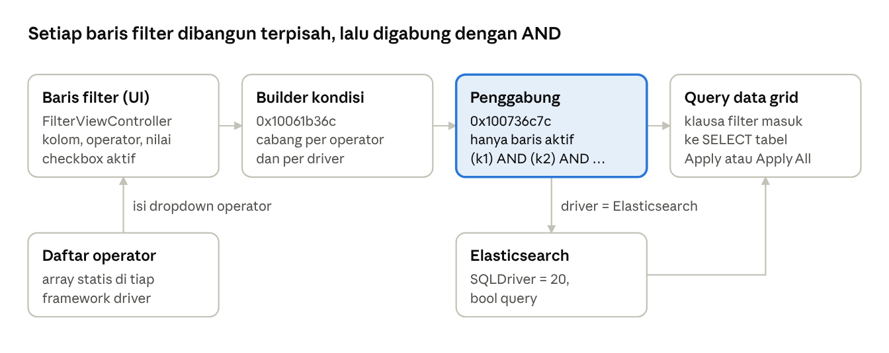

# Spec: Filter Data Grid TablePlus

2026-10-24 · Mas Gopal · [Versi live](https://claude.ai/artifact/QDjqyevFXAfqg3nAi7zMTz)

## Ringkasan

Filter data grid TablePlus 27.1.0 adalah daftar baris filter `kolom · operator · nilai`. Setiap baris diterjemahkan jadi satu kondisi teks oleh satu fungsi builder. Semua baris yang dicentang lalu digabung jadi `(k1) AND (k2) AND …`, kecuali Elasticsearch yang memakai bool query.

- **Daftar operator tidak global.** Setiap driver database menyimpan array operatornya sendiri di framework driver. PostgreSQL dan ClickHouse menambah varian *Case insensitive*, sedangkan MySQL, MariaDB, dan BigQuery menambah varian *Case sensitive*.
- **`Raw SQL` dan `Any column` bukan operator.** Keduanya entri pseudo-kolom di dropdown kolom. `Raw SQL` menyisipkan teks apa adanya, sedangkan `Any column` mengulang kondisi ke semua kolom yang digabung dengan `OR`.
- **Tidak ada pilihan OR antar baris filter.** Penggabung hanya mengenal `AND`, dan OR antar kondisi hanya bisa ditulis lewat `Raw SQL`.

Sumber analisis adalah slice arm64 dari `TablePlus` dan framework driver (binary di-strip, tanpa decompiler). Nama kelas berasal dari metadata ObjC/Swift, operator dari array statis tiap framework, dan template SQL dari string literal yang dirujuk fungsi builder. Template di bawah adalah rekonstruksi dari urutan literal tersebut, bukan pseudocode hasil decompile.

## Komponen dan alur



Dropdown operator diisi dari array driver aktif. Setiap baris diubah jadi satu kondisi oleh builder, lalu penggabung mengambil baris yang aktif saja dan menyambungnya dengan `AND`; hanya Elasticsearch yang dibelokkan ke bool query. Method ObjC `FilterViewController`: `addFilter:`, `removeFilter:`, `applyFilter:`, `applyQuery:`, `changeFomula:` (ejaan aslinya), dan `changeFilterColumn:`.

## Operator yang didukung

Ini operator yang muncul di dropdown kedua (`formulaDropdown`), dibaca dari array statis di setiap framework driver. Label di dropdown sekaligus menjadi nilai yang disimpan dan dibandingkan oleh builder.

| Driver | Operator |
| --- | --- |
| SQLite, DuckDB, LibSQL, Cloudflare D1 | `=` `<>` `<` `>` `<=` `>=` `IN` `NOT IN` `IS NULL` `IS NOT NULL` `BETWEEN` `NOT BETWEEN` `LIKE` Contains, Not contains, Has prefix, Has suffix |
| PostgreSQL (Redshift, Cockroach, Greenplum, dan Vertica tidak punya framework sendiri, jadi kemungkinan ikut daftar ini; belum diverifikasi) | Daftar SQLite + `ILIKE`, ditambah Contains / Not contains / Has prefix / Has suffix `- Case insensitive` |
| MySQL 5.7 / 9.7, MariaDB | Daftar SQLite, ditambah Contains / Not contains / Has prefix / Has suffix `- Case sensitive` |
| BigQuery | Daftar SQLite tanpa `LIKE`, ditambah varian `- Case sensitive` |
| ClickHouse (native dan HTTP) | Daftar SQLite tanpa `LIKE`, ditambah varian `- Case insensitive` |
| SQL Server, Oracle, Snowflake, Cassandra, Elasticsearch | Daftar SQLite tanpa `LIKE` |
| MongoDB (baru dan legacy) | `=` `<>` `<` `>` `<=` `>=` `IN` `NOT IN` `IS NULL` `IS NOT NULL` Contains, Not contains, Has prefix, Has suffix (tanpa `BETWEEN`) |
| DynamoDB | `=` `<>` `<` `>` `<=` `>=` |
| Redis | `=` Contains, Has prefix, Has suffix (pola `SCAN MATCH`) |

Perilaku nilai per operator (placeholder dari `0x100a1d0d4`):

| Operator | Isi kolom nilai | Placeholder |
| --- | --- | --- |
| `=` `<>` `<` `>` `<=` `>=` `LIKE` `ILIKE` | Satu nilai | `EMPTY` |
| `IN`, `NOT IN` | Daftar dipisah koma | `1, 2, 3` |
| `BETWEEN`, `NOT BETWEEN` | Dua batas dengan kata `AND` | `1 AND 100` |
| `IS NULL`, `IS NOT NULL` | Tidak dipakai | Placeholder tidak diisi |
| Contains, Not contains, Has prefix, Has suffix (dan varian case) | Teks biasa tanpa wildcard | `EMPTY` |

Dua entri di dropdown **kolom** mengubah arti baris filter. `Any column` menerapkan operator ke semua kolom. `Raw SQL` memakai isi kolom nilai sebagai potongan `WHERE` mentah, dan dropdown operator tidak lagi dipakai.

## Penerjemahan ke query

Satu fungsi, `0x10061b36c`, mengubah satu baris filter jadi satu string kondisi. Fungsi ini bercabang berdasarkan label operator (perbandingan string) dan driver. Hasilnya disisipkan sebagai klausa filter; WHERE, ORDER BY, dan LIMIT dirangkai di luar fungsi ini. Notasi: `c` = kolom (identifier sudah di-quote driver), `v` = isi kolom nilai, `v'` = `v` setelah escaping.

**Escaping nilai.** Tanda kutip tunggal digandakan (`'` → `''`). Untuk pola LIKE, backslash di-escape: MySQL/MariaDB `\` → `\\\\`, PostgreSQL `\` → `\\`. Tidak ada parameter binding; nilai disisipkan sebagai literal.

| Operator | Template SQL umum | Varian driver |
| --- | --- | --- |
| `=` `<>` `<` `>` `<=` `>=` | `c <op> 'v''` | Kolom biner: `X'<hex>'`; boolean PostgreSQL: `t` / `f` |
| `IN`, `NOT IN` | `c IN (v)` (daftar apa adanya) | Mongo `$in` / `$nin` |
| `BETWEEN`, `NOT BETWEEN` | `c BETWEEN v` (contoh `1 AND 100`) | Elasticsearch `range` + `gte`/`lte` |
| `IS NULL`, `IS NOT NULL` | `c IS NULL` | Mongo `{"$eq": null}`; Elasticsearch `exists` |
| `LIKE`, `ILIKE` | `c LIKE 'v''` (wildcard ditulis user) | `ILIKE` hanya PostgreSQL |
| Contains | `c LIKE '%v'%'` | PostgreSQL `c::TEXT LIKE '%v'%'`; MySQL Case sensitive `(BINARY c LIKE '%v'%')` |
| Contains - Case insensitive | — | PostgreSQL `c::TEXT ILIKE '%v'%'`; ClickHouse memakai `ILIKE` |
| Not contains | `c NOT LIKE '%v'%'` | PostgreSQL `c::TEXT NOT LIKE …` / `NOT ILIKE` |
| Has prefix | `c LIKE 'v'%'` | — |
| Has suffix | `c LIKE '%v''` | — |
| `Raw SQL` (pseudo-kolom) | `v` apa adanya | — |

**Any column.** Kondisi diulang untuk setiap kolom tabel, digabung `OR`, dan dibungkus kurung, misalnya `((c1 IS NULL) OR (c2 IS NULL) …)` atau `(c1 LIKE '%v%' OR c2 LIKE '%v%' …)`; posisi kurung persisnya per operator belum diverifikasi. Untuk Not contains, ada literal `(NOT (` … `))`, jadi negasinya kemungkinan membungkus seluruh OR. Ini perlu diverifikasi.

**Kolom JSON/JSONB PostgreSQL.** Contains memakai containment: `c @> 'v''::jsonb`, sedangkan Not contains `(NOT (c @> 'v''::jsonb))`. Varian case-insensitive memakai `lower(c::text)::jsonb @> …`.

**Driver non-SQL** (template dari literal di fungsi yang sama):

| Driver | Bentuk keluaran |
| --- | --- |
| MongoDB | Fragmen JSON `"c": {…}`: Contains `{"$regex": ".*v.*", "$options": "i"}`, Not contains `{ "$not": {"$regex": …} }`, Has prefix `"^v.*"`, Has suffix `".*v$"`, perbandingan `{ "$lt": v }` dan seterusnya; kolom `_id` dibungkus `{ "$oid": "v" }` |
| DynamoDB | JSON `{"FilterExpression": "c = :c", "ExpressionAttributeValues": {":c": {"S" atau "N": "v"}}}` |
| Redis | Pola `SCAN`: `=` → `MATCH v`, Contains → `MATCH *v*`, Has prefix → `MATCH v*`, Has suffix → `MATCH *v` |
| Elasticsearch | Query DSL: `wildcard` dengan `case_insensitive`, `range`, `exists`, `match_none` |
| Cassandra | Query diberi akhiran ` ALLOW FILTERING;` |

## Kombinasi beberapa filter

Baris filter yang dicentang selalu digabung dengan `AND`. Setiap kondisi dibungkus kurung lebih dulu, jadi operator di dalam satu baris (misalnya `OR` dari `Any column` atau `Raw SQL`) tidak bocor ke baris lain.

1. Penggabung (`0x100736c7c`) mengiterasi baris filter dan memanggil builder baris (`0x100a1db28` → `0x10061b36c`) untuk tiap baris.
2. Hanya baris dengan checkbox `isFilterEnabled` aktif yang ikut. Tooltip-nya berbunyi "Include/exclude this filter when Apply All".
3. Driver dibaca lewat vtable (`+0x138`). Jika driver = Elasticsearch (case ke-20 `SQLDriver`), kondisi diserahkan ke `0x100635cc0` dengan argumen `"AND"`, yang menyusun bool query Elasticsearch (ada literal `minimum_should_match`).
4. Untuk driver lain, setiap kondisi menjadi `"(" + k + ")"`, lalu digabung dengan `joined(separator: " AND ")`.

Contoh untuk tiga baris filter (`status` `=` `paid`; `total` `BETWEEN` `100 AND 500`; `Raw SQL` `note IS NOT NULL OR memo <> ''`) di PostgreSQL:

```sql
("status" = 'paid') AND ("total" BETWEEN 100 AND 500) AND (note IS NOT NULL OR memo <> '')
```

**Apply vs Apply All.** Tombol `Apply` pada satu baris (`applyFilter:`) memakai kondisi baris itu saja; label tombol berubah jadi `Applied`. Apply All memakai semua baris yang dicentang. Popover pratinjau (`FilterPreviewerPopover`) menampilkan keduanya di bawah judul `-- Current filter --` dan `-- All checked filters --`.

**Tidak ada OR, grup, atau urutan prioritas antar baris.** Di UI tidak ada kontrol AND/OR, dan penggabung tidak punya cabang `OR`. Satu-satunya jalan untuk OR antar kondisi adalah satu baris `Raw SQL`, misalnya `status = 'paid' OR status = 'refunded'`, yang otomatis dikurung.

**Batas lisensi.** Pada mode trial, filter yang dipulihkan dibatasi 2 baris ("Free Trial limited 2 filters").

## Edge case, default, dan persistensi

- **NULL dan string kosong.** `NULL` hanya bisa dicari lewat `IS NULL` / `IS NOT NULL`. `= ''` menghasilkan perbandingan dengan string kosong, bukan NULL.
- **IN dan BETWEEN tidak di-escape per item.** Isi nilai disalin apa adanya ke `IN (…)` atau `BETWEEN …`, jadi string harus dikutip sendiri oleh user (`'a', 'b'`). Ini kesimpulan dari placeholder `1, 2, 3` dan `1 AND 100` serta tidak adanya literal pemisah item di builder; perlu diuji di runtime.
- **Wildcard di Contains/prefix/suffix.** `%` dan `_` yang diketik user tidak ditemukan escaping-nya, jadi kemungkinan tetap bertindak sebagai wildcard.
- **Kolom JSON/JSONB PostgreSQL** memakai `@>` alih-alih `LIKE`, sehingga Contains di kolom ini berarti containment JSON, bukan substring.
- **Quick Filter** (menu konteks sel "Filter with column", fungsi `0x100645ef4`) membuat baris filter dari nilai sel terpilih: `c = 'v'`, Not contains, Has prefix, Has suffix, `c IN (…)`, `c NOT IN (…)`, `IS NULL`, dan `IS NOT NULL`.

Setting global (halaman Settings, fungsi `0x1007418e4`):

| Setting | Pilihan yang terlihat |
| --- | --- |
| Default Filter Column Sort | By Name, By Ordinal Position |
| Default Filter Column | Kolom tabel atau `Raw SQL` |
| Default Filter Operator | Default `=` |
| Default Filter State | `auto`, Remember the last state |

**Persistensi.** Setiap baris filter disimpan sebagai objek dengan kunci `column`, `formula`, `value`, dan `isEnabled`. Saat dipulihkan (`0x10073a0d0`), mode trial memotong jumlahnya jadi 2 dengan pesan "Some filters could not be restored because of the free limitations."

## Bukti dan tingkat keyakinan

Semua alamat merujuk ke slice arm64 TablePlus 27.1.0 (build 830). Tidak ada decompiler yang tersedia, jadi bukti berasal dari metadata, string, dan pembacaan assembly secara manual.

| Klaim | Bukti | Keyakinan |
| --- | --- | --- |
| Daftar operator per driver | Array small-string statis di tiap framework driver, berurutan `=` … Has suffix | Tinggi |
| Varian case per driver | Label `- Case (in)sensitive` hanya ada di framework PostgreSQL, ClickHouse, MySQL, MariaDB, dan BigQuery | Tinggi |
| `Raw SQL` / `Any column` sebagai pseudo-kolom | Ditambahkan ke `columnDropdown` di setup `0x100a1e3d8`; NIB berisi `Any column` di menu kolom | Tinggi |
| Penggabungan `(k) AND (k)` | Assembly `0x100736c7c`: literal `(` dan `)` per item, lalu `joined(separator: " AND ")` | Tinggi |
| Cabang Elasticsearch | Pemeriksaan `SQLDriver == 20` lalu memanggil `0x100635cc0` dengan argumen `"AND"` | Tinggi |
| Template SQL per operator | Urutan literal di builder `0x10061b36c`; susunan persis antar-literal belum dibaca instruksi demi instruksi | Sedang |
| Escaping `'` → `''` dan backslash | Literal `'`/`''`, `\`/`\\`/`\\\\` di cabang LIKE | Sedang |
| `IN`/`BETWEEN` disalin apa adanya | Placeholder `1, 2, 3` / `1 AND 100`, tanpa literal pemisah item | Rendah–sedang |
| Interaksi dengan sort, paging, dan LIMIT | Tidak ditelusuri | Terbuka |

Langkah verifikasi berikutnya: hubungkan TablePlus ke database SQLite uji, buat satu baris filter untuk setiap operator, lalu salin SQL dari popover pratinjau atau Console log. Langkah ini akan mengonfirmasi template, kurung `Any column`, dan escaping.
